<!-- Profile README for abdullah5341 · hand-built SVGs in /assets · qubit game in /scripts -->

<p align="center">
  
</p>

<p align="center">
  <a href="https://www.linkedin.com/in/abdullah5341/"><b>LinkedIn</b></a> &nbsp;⟩&nbsp;
  <a href="mailto:abdullahmahmood12004@gmail.com"><b>Email</b></a> &nbsp;⟩&nbsp;
  <a href="https://github.com/abdullah5341?tab=repositories"><b>Projects</b></a> &nbsp;⟩&nbsp;
  <b>📍 Nilai, Malaysia</b> &nbsp;·&nbsp; <b>🇵🇰 Karachi</b>
</p>

<br/>

## `|whoami⟩`

I'm **Abdullah**, an engineer who likes problems with real stakes. I write production software for an accounting platform. I've built a scheduler that made a real automotive plant run faster. I've taught engineering students at the university I graduated from. And I do research on whether quantum AI can be trusted in a hospital.

What ties it together: **I build things that work outside the demo**, and I measure them honestly.

<p align="center">
  
</p>

## `|what I bring⟩`

<table>
<tr>
<td width="33%" valign="top">

### 🛠️ Engineer
**Software Engineer @ Splendid Accounts**

I build and maintain web apps in **C#, ASP.NET Core, Angular and SQL Server**. I design REST APIs, tune slow SQL queries and fix production issues in an Agile team. Before this I did full-stack work, QA and Android UI at **HudaSoft**, working with international clients.

</td>
<td width="33%" valign="top">

### 🏭 Problem-solver
**Planfinity × Atlas Autos**

I wrote the optimiser for a real factory's production schedule: constraint satisfaction with backtracking, **MRV/LCV** heuristics and rule-based priorities, on a Django platform. In a one-month pilot the plant had **32% less machine idle time** and **27% more output**.

</td>
<td width="33%" valign="top">

### 🎓 Educator & researcher
**Visiting Faculty @ NED University**

I taught at NED right after graduating in the First Division. Now I'm doing an **M.Sc. in Malaysia** alongside independent **quantum ML** research, and I'm aiming for a PhD.

</td>
</tr>
</table>

## `|journey⟩`

<p align="center">
  
</p>

## `|built⟩`

| | Project | What it is | Stack |
|:-:|---|---|---|
| 🏭 | **Planfinity** | Production planning & scheduling for Atlas Autos' D.I.D plant | Python · Django · CSP |
| 📦 | **Smart Inventory & Demand Forecasting** | Stock tracking that predicts demand | Python · ML |
| 👕 | [**Virtual Try-On**](https://github.com/abdullah5341/virtual-tryon-app) | Try clothes on virtually in the browser | JavaScript |
| 🎬 | [**MovieMax**](https://github.com/abdullah5341/MovieMax-main) | Netflix-style streaming UI | React · Redux · TypeScript |
| 🔎 | [**Job Search**](https://github.com/abdullah5341/job-search) | Job listing and search app | TypeScript |
| 📈 | **Trend Analyzer** | Shopify trend analytics | Shopify |
| 📝 | [**OCR Web**](https://github.com/abdullah5341/ocr-web) | Extract text from images in the browser | Web |
| ⚽ | [**Football Club**](https://github.com/abdullah5341/football_club) | Club website with a database | PHP · SQLite |

## `|research⟩`

<p align="center">
  
</p>

**Quantum ML × medical AI — in progress 🔒.** I'm studying how far quantum machine-learning models can be trusted for clinical decisions, and how to compare them with classical models fairly. A manuscript is in preparation. Results will appear here once they're public, and I'm happy to talk about the direction in the meantime.

## `|stack⟩`

```python
|stack⟩ = 0.55 |C# · ASP.NET Core · Angular · SQL Server · REST APIs⟩
        + 0.50 |React · Redux · TypeScript · Node · Express · Django⟩
        + 0.50 |Python · PennyLane · scikit-learn · XGBoost · pandas⟩
        + 0.45 |Docker · Azure · Git · DevOps · Streamlit⟩
# ⟨stack|stack⟩ ≈ 1   · certified: DevOps · Node & Express (Microsoft) · React (GDSC) · IC Design · Ethical Hacking
```

## `|play⟩` collapse my qubit

<!-- QUBIT:START -->
<div align="center">


**Right now my qubit is in** &nbsp;`|ψ⟩ = 0.707|0⟩ + 0.707·e^(i0.00)|1⟩`

P(|0⟩) = **50%** &nbsp;·&nbsp; P(|1⟩) = **50%** &nbsp;— guess the outcome, then collapse it:

<a href="https://github.com/abdullah5341/abdullah5341/issues/new?title=qubit%7C0&body=Just%20press%20%2A%2ASubmit%20new%20issue%2A%2A%20%F0%9F%91%87%20%E2%80%94%20a%20GitHub%20Action%20will%20measure%20the%20qubit%2C%20update%20the%20README%20and%20reply%20here%20within%20about%20a%20minute."></a>&nbsp;&nbsp;<a href="https://github.com/abdullah5341/abdullah5341/issues/new?title=qubit%7C1&body=Just%20press%20%2A%2ASubmit%20new%20issue%2A%2A%20%F0%9F%91%87%20%E2%80%94%20a%20GitHub%20Action%20will%20measure%20the%20qubit%2C%20update%20the%20README%20and%20reply%20here%20within%20about%20a%20minute."></a>

<sub>No one has collapsed it yet — be the first observer.</sub>

</div>
<!-- QUBIT:END -->

<sub>Click a guess, then press <b>Submit</b>. A GitHub Action measures the qubit using the Born rule, updates this page and replies to you.</sub>

## `⟨you|me⟩`

The overlap is never zero. I'm open to **software engineering roles**, **research collaborations** and **PhD positions** in quantum ML or trustworthy medical AI.

<p align="center">
  <a href="https://www.linkedin.com/in/abdullah5341/"><b>→ Connect on LinkedIn</b></a> &nbsp;&nbsp;
  <a href="mailto:abdullahmahmood12004@gmail.com"><b>→ abdullahmahmood12004@gmail.com</b></a>
</p>
